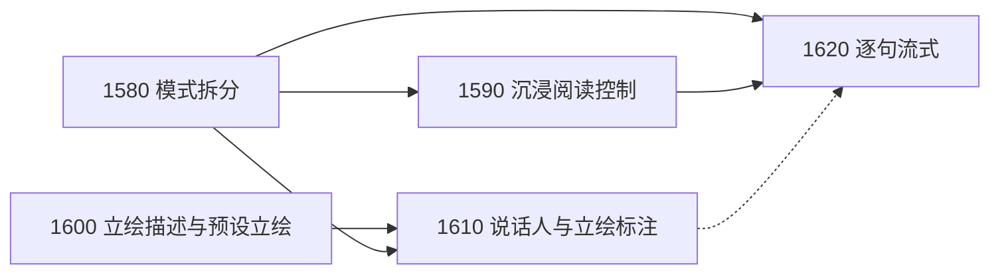

# Play 角色对话 GalGame 化规划

> 日期：2026-11-12
> 代码基线：`fd764cc`
> 状态：已立项。作者于 2026-11-12 确认：拆分舞台模式与专业模式；不做实时生图，先用角色预先准备的立绘，并在角色卡中增加立绘描述。拆为 [1580](../tasks/1580.md)–[1620](../tasks/1620.md) 五个 Planned task，实施计划待写。
> 定位依据：[PROJECT_VISION](../PROJECT_VISION.md)。Play 优先，服务个人同人/综漫创作；不做商业化 VN 引擎。

## 1. 结论

[1360](../tasks/1360.md) P3 已交付一个可用的视觉小说舞台：分句、说话人推断、冻结背景/立绘、打字机、数字键选项、历史回看。它目前更像“把一段回复拆成字幕回放”，离 GalGame 手感还差：

1. **舞台不沉浸**：舞台嵌在工作台中间，下方仍是完整的 `PlayComposer` 与各类面板；没有自动播放、快进、隐藏 UI、按句回看；作者自己的行动不上舞台。
2. **角色只有一张脸，也没有可读的立绘说明**：名册只有 `looks.refImagePath` 一张图；裁判不知道有哪些立绘可用、每张是什么样子。
3. **谁在说话靠猜**：说话人只靠 `inferSpeaker` 的正则与名册别名推断。
4. **不是真的逐句出现**：叙事被 `createPlayNarrativeStreamFilter` 隔离到 settlement 围栏出现后才整段放出。

作者决策：

- **拆分舞台模式与专业模式**：同一会话的两种呈现，随时切换；不拆会话类型、不分叉协议。
- **不做实时生图**：立绘全部来自作者预先放进工作区的图片；系统只读取、冻结、展示，不生成、不修改、不复制图片。
- **角色卡增加立绘描述**：每张立绘有文字描述，作者可读，也供裁判选择表情；没有图片时描述照样可用，以后接生图时也能直接作为输入。

| 编号 | Task | 作者获得的能力 | 改动面 | 优先级 / 规模 |
| --- | --- | --- | --- | --- |
| V1 | [1580](../tasks/1580.md) 舞台模式与专业模式拆分 | 沉浸的舞台模式与完整的专业模式随时切换，草稿与回合不丢 | Desktop UI | P0 / M–L |
| V2 | [1590](../tasks/1590.md) 舞台沉浸阅读控制 | 自动 / 快进 / 隐藏 UI / 按句回看 / 字速；自己的行动也上舞台 | Desktop UI | P0 / M |
| V3 | [1600](../tasks/1600.md) 角色立绘描述与预设立绘集 | 角色卡里写多张立绘及其描述与名字牌颜色，舞台显示作者准备的图 | Core 名册 + 会话冻结 + UI | P0 / M |
| V4 | [1610](../tasks/1610.md) 显式说话人与立绘标注 | 裁判直接标出谁在说、用哪张立绘，不再靠猜 | Core 协议 + 宿主解析 + UI | P1 / M–L |
| V5 | [1620](../tasks/1620.md) 舞台模式逐句流式演出 | 第一句写完就开始演出 | Backend 流式过滤 + UI 显示队列 | P1 / M |

规模是相对复杂度，不是工期承诺。

## 2. 现状核对

| 能力 | 现状 | 证据 |
| --- | --- | --- |
| 舞台布局 | 由 `visualNovelOpen` 开关嵌在 `play-stage-center`；`PlayComposer` 与面板常驻 | `PlayWorkspace.vue`（949 行）、`VisualNovelStage.vue` |
| 推进手感 | 第一击补全、第二击下一句；固定 24ms/字；无自动、快进、字速设置 | `VisualNovelTextBox.vue` |
| 历史回看 | 按回合列出原始 `turn.content`；不按句、无名字牌 | `VisualNovelStage.vue` `.vn-log` |
| 玩家行动 | `speaker === 'user'` 的回合被过滤，不上舞台 | `VisualNovelStage.vue` |
| 说话人 | 正则 + 名册别名 + 行当称谓 + `NOT_NAME` 排除表 | `text-speaker-parser.ts` |
| 立绘 | 每角色一张 `looks.refImagePath`，创建会话时冻结为 data URL | `character-roster.ts`、[PLAY_LOCAL_SCENERY](../PLAY_LOCAL_SCENERY.md) |
| 名册来源 | 只有 Forge 生成 `roster-profile.yaml`；无编辑表单；Tavern 导入只取 PNG 内的 JSON，图片丢弃 | `forge.ts`、`tavern-card.ts` |
| 二进制写入 | Sandbox Change Engine 只处理 UTF-8 文本 | `revision-impact.ts`、`SANDBOX_CHANGE_ENGINE.md` |
| 流式 | 后端每回合创建一次过滤器；围栏前全部隔离，fail-closed | `backend/src/index.ts` `streamPlayRefereeText`、`play-narrative-stream.ts` |

参考资料：[CicaTavern 分析 §3.4](../research/CICATAVERN_REFERENCE_ANALYSIS.md)、[Live Visual Novel 分析 §3.2 / §5.1](../research/LIVE_VISUAL_NOVEL_REFERENCE_ANALYSIS.md)。

## 3. 各项设计

### 3.1 舞台模式与专业模式拆分（1580）

同一会话的两个外壳，共享一套会话与回合状态：

| 舞台模式 | 专业模式 |
| --- | --- |
| 背景、立绘、对话框、选项、自己写、改一改 | 世界面板、事件流、原作节点表、关系面板 |
| 停止、重演、存档点跳转的简化入口 | 采纳、角色贴合度检查、世界线比较 |
| 固定玩家视角 | 可切导演视角 |
| 1620 后逐句流式 | 围栏前不放出叙事（现状） |
| — | 上下文追踪、用量、消息日志 |

关键约束：输入草稿、进行中的回合、选中分支属于共享状态，切换不丢；舞台模式强制关闭导演视角；v5 场景排练在舞台模式只读回放。模式偏好按会话记在应用界面偏好中，不写小说工作区。

### 3.2 舞台沉浸阅读控制（1590）

窗口全屏；点击/空格/回车两段式推进，连点不吞输入；滚轮下翻下一句、上翻打开回看；快捷菜单 Auto / Skip / Log / 隐藏 UI / 设置；字速、自动间隔、对话框不透明度设置存应用偏好；按句回看带名字牌，可跳回某句只读重播；作者行动以主角台词或旁白上舞台；说话者高亮、其余变暗；场景与立绘变化淡入淡出，reduced motion 下关闭。不改协议、不调模型，也不改名册格式：名字牌颜色沿用现有的文本哈希色，名册里有 1600 提供的 `looks.nameColor` 时优先使用。

### 3.3 角色立绘描述与预设立绘集（1600）

在 `characters/<id>/roster-profile.yaml` 增加可选 `portraits` 段：

```yaml
portraits:
  default: normal
  items:
    - id: normal                       # 1–32 位 ASCII，角色内唯一
      label: 平常                       # 名字牌旁与表单显示
      description: 双手背在身后，微微歪头，嘴角带一点笑。校服外套敞开。
      usage: 日常对话、平静时           # 可选，什么时候用这张
      image: characters/nian/portraits/normal.png   # 可选；没有图也可以只写描述
    - id: angry
      label: 生气
      description: 叉腰，眉头皱起，脸颊鼓着。
      image: characters/nian/portraits/angry.png
```

- `looks.refImagePath` 继续有效：没有 `portraits` 时视为唯一默认立绘；两者同时存在时以 `portraits` 为准，表单提示迁移。
- **图片只读**：图片由作者自己放进工作区（建议 `characters/<id>/portraits/`），系统只读取、冻结、展示，不生成、不复制、不修改。`image` 路径规则与现有 `refImagePath` 相同。
- **编辑入口**：角色页的“立绘”表单，列出该角色目录下已有的图片供选择，填写标签、描述、用途；保存生成确定性 CandidateChangeSet → PendingAction，Git diff 审批后写入。
- **Forge**：生成角色时可起草立绘描述（只有描述，不带图片），随现有 Forge 审批流程写入。
- **会话冻结**：创建会话时冻结立绘描述与图片字节；每角色最多 8 张、单张 256 KiB，全会话立绘合计默认不超过 8 MiB（默认值，实施计划按 [1260](../tasks/1260.md) 的存储成本实测调整），超出跳过并提示，不使创建失败。
- **舞台展示**：先显示默认立绘；没有图片的立绘显示名字剪影并可悬停看描述。
- **名字牌颜色**：`looks` 增加可选 `nameColor`（`#RRGGBB`），与立绘在同一张表单里编辑。
- **上下文**：本任务不改变 Play 冻结前缀与回合请求，立绘描述只用于表单与舞台显示。描述进入冻结前缀只发生在 1610 启用演出标注的会话里。写作侧不因本任务多读任何内容。
- 更新 [FILESYSTEM_SPEC](../FILESYSTEM_SPEC.md)、[PLAY_LOCAL_SCENERY](../PLAY_LOCAL_SCENERY.md) 与 final validator。

### 3.4 显式说话人与立绘标注（1610）

会话创建时可选“演出标注”（保留键暂名 `vnStageMarkup`，旧会话不能追加）。启用后冻结前缀给出在场可用角色与其立绘 `id + label + description + usage`，并规定对白行写作：

```text
@nian[angry] “你又迟到了！”
```

宿主在回合提交时解析标记，写入 `StageSnapshot.beats[].speakerId / portraitId / source`，transcript 正文存剥离标记后的纯文本；写作交接、角色贴合度引文、阶段归档只看干净正文。未知角色或立绘降级为默认立绘或启发式推断并记提示，格式错乱行按旁白处理，回合不因标注失败。未启用会话在前缀、请求、存储上逐字节不变。标记不承载事实与隐藏信息，settlement 协议不变。

两点需要在实施计划中落实：

- **模型看到的历史要带标记。** transcript 存的是干净正文；如果后续回合的历史也用干净正文，模型会看到自己此前没有写标记，遵循率容易下降。默认做法：启用标注的会话在组装历史时，由宿主按已保存的 `speakerId / portraitId` 把标记重新加回对白行（只对 `source: 'markup'` 的行），不另存一份带标记的正文。实施前先核对现有历史组装路径，确认这样做不破坏冻结前缀的缓存布局。
- **任何草稿都不显示原始标记。** 专业模式现有的流式草稿在围栏后整段放出，也要先剥离标记；舞台模式由 1620 的整行放行处理。

### 3.5 舞台模式逐句流式演出（1620）

回合请求增加 `presentation: 'stage' | 'workbench'`，后端按回合选择过滤器（请求发出时固定，中途切换模式只改显示）：

- `workbench`：现有 fail-closed 过滤器，不变。
- `stage`：围栏出现前只放出“已完整结束且通过 `isSafePlayNarrativePrefix`”的整句；遇到可疑片段立即停止放行，余下回到隔离路径。启用 1610 时标记行整行到齐才放行。
- 前端显示队列按字速逐句播放，与网络到达节奏解耦。放出内容始终是“草稿 · 尚未保存”；最终解析失败、停止或重演时整体撤下。

**这是对既有边界的有意改变。** 现有过滤器是特意用延迟换 fail-closed 的：没有围栏的回复永远不上屏。[2026-11-06 路线图](NEXT_FEATURE_ROADMAP_2026-11-06.md) 候选池也写过“保留 settlement 隔离，不承诺提前释放未经校验的正文”。作者选择在舞台模式放宽它，专业模式不变。放宽后仍然成立与不再成立的保证：

- 仍成立：结构化片段（花括号、围栏、settlement 字段名）不会出现在草稿里；未通过最终解析的内容不会被保存。
- 不再成立：一个最终解析失败的回复，其开头几句可能已经被作者看到，随后被撤下。
- 逐句检查挡不住的：模型把本该对玩家隐藏的信息写进一句普通叙述。这一点在现有整段放出的路径上同样存在，逐句流式不使它更糟，但也不解决它。

## 4. 不做

- 不接实时生图、抠图、TTS、语音克隆（沿用 1360 边界）；Play 运行中只读取已写入的图片。独立的立绘生图模块见 [角色立绘生图模块规划](PORTRAIT_IMAGE_GENERATION_PLAN_2026-11-12.md)（1630–1650），立绘的 `prompt` 字段随 1600 一起落地。
- 本规划内不扩展 Sandbox Change Engine 的二进制写入；该扩展由 [1630](../tasks/1630.md) 单独完成。
- 不引入幕制/NDJSON 剧本协议或“导演 + 编剧”两级模型调用；settlement 协议不变。
- 不做好感度数值、个人线/结局锁定；关系变化继续由 [1470](../tasks/1470.md) 表达。
- 不做商业 VN 引擎能力（脚本编辑器、时间轴、导出可执行游戏）。

## 5. 候选池（不立项）

- Tavern PNG 卡图片作为默认立绘：依赖 [1630](../tasks/1630.md) 的经审批图片写入。
- 场景 BGM / 环境音：本地音频，需要单独的冻结与预算方案。
- 回合关系变化浮层提示（数据来自 1470，只读）。
- 带背景缩略图的存档/读档格子界面。
- 立绘位置与入退场由标记显式指定（`@nian[angry|左]`）。

## 6. 顺序与依赖



- 1580 与 1600 互不依赖，可并行；先做 1580 能最快改善体验。
- 1610 需要 1580 的舞台呈现与 1600 的立绘 id/描述。
- 1620 需要 1580 的舞台外壳与 1590 的字速设置；与 1610 同时启用时遵守整行放行。

测试放在 `__test__/core/`、`__test__/backend/`、`__test__/desktop-ui/`。协议与接线用受控模型验证；真实模型的标注遵循率与演出观感由作者另行验收。
