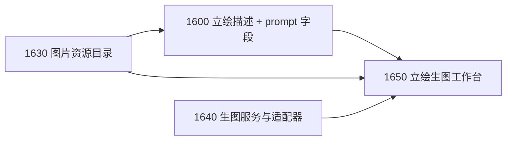

# 角色立绘生图模块规划

> 日期：2026-11-12
> 代码基线：`fd764cc`
> 状态：已立项。作者于 2026-11-12 要求增加独立的角色立绘生图模块，对接 ComfyUI HTTP 接口或在线生图 API，并在角色卡立绘中增加生图提示词字段。拆为 [1630](../tasks/1630.md)–[1650](../tasks/1650.md) 三个 Planned task，并扩展 [1600](../tasks/1600.md) 的立绘字段。实施计划待写。
> 2026-11-12 追加决定：图片资源单独存放、不提交 Git；舞台使用原图；变更引擎只负责图片路径，不管图片内容。此前“经审批的二进制图片变更 / ADR 0005”的设计作废，1630 改为图片资源目录。
> 关联：[Play 角色对话 GalGame 化规划](PLAY_GALGAME_PRESENTATION_PLAN_2026-11-12.md)。

## 1. 结论

生图是一个**独立模块**，由作者在“立绘生图”页面显式触发；Play 推演运行中不调用生图，舞台只显示已经放进图片资源目录的图片。这与 [1360](../tasks/1360.md) “Play 不调用生图 / TTS”的边界一致：边界针对 Play 运行时，不针对独立的素材准备模块。

| 编号 | Task | 作者获得的能力 | 改动面 | 优先级 / 规模 |
| --- | --- | --- | --- | --- |
| G0 | [1600](../tasks/1600.md)（扩展） | 每张立绘可保存生图提示词 | Core 名册字段 + 表单 | 随 1600 |
| G1 | [1630](../tasks/1630.md) 图片资源目录与路径引用 | 图片有固定的存放位置，不进 Git；可导入图片，正式文件只记路径 | Core 工作区 + Backend 资源接口 + FILESYSTEM_SPEC | P0 / S–M |
| G2 | [1640](../tasks/1640.md) 生图服务配置与适配器 | 配置本地 ComfyUI 或在线生图 API，测试连通 | Core 类型 + Backend 适配器 + 全局配置 + Desktop 设置 | P1 / M–L |
| G3 | [1650](../tasks/1650.md) 角色立绘生图工作台 | 选角色与立绘 → 生成候选 → 挑一张 → 存入资源目录并审批角色卡里的路径 | Backend 任务 + Desktop 页面 | P1 / L |

顺序：1630 → 1600；1640 可与它们并行；最后 1650。1640 单独交付没有作者可见的成果，所以与 1650 同为 P1；1630 是 P0，因为 1600 的图片路径依赖它。

本规划改变了此前“生图不进入范围”的记录（[DEVELOPMENT_PLAN](../DEVELOPMENT_PLAN.md)、[2026-11-06 路线图](NEXT_FEATURE_ROADMAP_2026-11-06.md)）；两处已加注 2026-11-12 的更新。TTS 仍不做。

## 2. 现状核对

| 事实 | 依据 |
| --- | --- |
| 名册 `looks` 已有 `fixedBooruTags`、`outfitTags`、`loraName`、`loraTrigger`，预留给生图，但无任何调用方 | `character-roster.ts` |
| Sandbox Change Engine 只接受无 NUL 的 UTF-8 文本，create 固定 mode `0o644` | [SANDBOX_CHANGE_ENGINE](../SANDBOX_CHANGE_ENGINE.md) §change 合同 |
| LLM provider 配置是应用级全局配置 `llm-providers.json`，`apiKey` 对前端脱敏为 `hasApiKey` | `llm-provider.ts`、[0540](../tasks/0540.md) |
| 所有模型调用统一走 Vercel AI SDK；`ai@7` 提供 `generateImage` | `packages/*/package.json`、[ADR 0002](../adr/0002-no-heavy-agent-frameworks.md) |
| 现有立绘与场景图在开局时读成 data URL 存进会话，单张上限 256 KiB；新的 `portraits` 立绘不走这条路 | [PLAY_LOCAL_SCENERY](../PLAY_LOCAL_SCENERY.md)、[1600](../tasks/1600.md) |

## 3. 各项设计

### 3.1 立绘生图提示词字段（扩展 1600）

`portraits.items[]` 增加可选 `prompt`；采纳生成图后写入可选 `generation` 来源记录：

```yaml
portraits:
  default: normal
  items:
    - id: normal
      label: 平常
      description: 双手背在身后，微微歪头，嘴角带一点笑。
      image: assets/portraits/nian/normal.png
      prompt:
        positive: smile, hands behind back, head tilt, school uniform, upper body
        negative: lowres, bad hands, extra fingers
        useCharacterTags: true      # 默认 true：自动拼上 looks.fixedBooruTags / outfitTags / LoRA 触发词
      generation:                   # 由 1650 采纳时写入，作者也可删除
        provider: comfyui-local
        model: animagine-xl-4.0
        seed: 123456789
        size: 832x1216
        workflowHash: sha256:…
        promptHash: sha256:…
        generatedAt: 2026-11-12T20:00:00+08:00
```

- `prompt` 是纯文本，没有生图模块时也可以编辑保存；提示词语言不限。
- 最终提示词由 Core 纯函数组合：角色固定 tags + 服装 tags + LoRA 触发词 + 本立绘 `positive`；`negative` 叠加服务的默认负面词。组合结果在生成前可预览、可临时修改，临时修改不回写，除非作者显式保存。
- `generation` 只记来源，不含 API Key、服务地址或完整工作流内容。

### 3.2 图片资源目录与路径引用（1630）

作者决定：图片单独存放，不提交 Git；变更引擎只负责图片路径。所以不扩展 Sandbox Change Engine，不写 ADR，现有“只支持 UTF-8 文本”的合同原样保留。

- **资源目录**：工作区内一个被 Git 忽略的普通文件夹（默认 `assets/`，立绘在 `assets/portraits/<角色 id>/`），写入 [FILESYSTEM_SPEC](../FILESYSTEM_SPEC.md)。它不是正式小说内容，不参与候选与审批，Agent 读不到也列不出。
- **谁能写**：作者自己放文件；或者作者在界面上显式触发的两个动作——“导入图片”（复制本机文件）和“采用”（存入 1650 的生成图）。宿主不在后台写图片。
- **只新增不覆盖**：文件名冲突时自动改名，同一内容重复存入时复用已有文件。这样角色卡的路径变更被拒绝时，原来引用的图片一定还在。
- **路径是唯一的正式记录**：角色卡里的 `image` 是一行 YAML 文本，它的修改照常走 CandidateChangeSet → PendingAction → Git diff 审批。审批界面可以在路径旁显示图片供对照。
- **读取**：按路径把原图交给界面显示，不缩放、不转码；只读 PNG / JPEG / WebP，校验签名，拒绝符号链接与越界路径，单文件有大小上限（默认 16 MiB）。
- **缺图不是错误**：图片不随 Git 走。文件缺失或损坏时引用处显示占位并说明原因。
- **清理**：可以列出没有被任何正式文件引用的图片，由作者决定是否删除；系统不自动删除。

这个做法的取舍：审批不再覆盖图片内容本身——“采用”那一下点击就是对图片的确认，Git 历史里也看不到图片的变化；换来的是仓库不膨胀、舞台能用原图、变更引擎不动。

### 3.3 生图服务配置与适配器（1640）

- **全局配置** `image-providers.json`，与 `llm-providers.json` 同目录、同样的脱敏规则；不进入小说工作区。
- **适配器接口**（Core 只定义类型；网络调用在 Backend）：
  ```ts
  interface PortraitImageRequest { positive: string; negative?: string; width: number; height: number; seed?: number; count: number; }
  interface PortraitImageResult { images: Array<{ bytes: Uint8Array; mediaType: 'image/png' | 'image/jpeg' | 'image/webp'; seed?: number }>; providerMeta: Record<string, string | number> }
  ```
- **ComfyUI HTTP 适配器**：
  - 作者导入 ComfyUI “API 格式”工作流 JSON，并指定占位映射（正向 / 负向提示词、种子、宽高、批量、LoRA 节点等）；也可在 JSON 中使用 `{{positive}}` 等占位符。
  - 流程：`POST /prompt` → 轮询 `GET /history/{prompt_id}` → `GET /view` 取图；支持 `POST /interrupt` 取消；`GET /system_stats` 做连通测试。
  - 默认只允许 loopback 地址；远程地址需在设置中显式开启并提示风险。工作流文件存全局配置目录，记录 hash。
- **在线 API 适配器**：走 Vercel AI SDK `generateImage`，复用已有 provider 包（如 `@ai-sdk/openai`）；需要额外 provider 时在实施计划中按固定版本引入。不手写私有 HTTP 客户端。
- **用量与外发记录**：每次生图请求按 [1110](../tasks/1110.md) 已有的做法记一条外发记录：服务 id 与类型、模型、地址的 origin、张数与尺寸、耗时与结果；不记提示词原文、图片内容、API Key 或完整地址。本机 loopback 的 ComfyUI 也记录，标为本地。
- **统一约束**：请求超时、单次最多张数、返回图片字节上限、魔数校验；失败给出具体原因（不可达、鉴权失败、超时、内容被拒、返回格式错误）。
- **设置页**：新增、编辑、删除服务，测试连通；API Key 只写不回显。

### 3.4 角色立绘生图工作台（1650）

- 独立页面“立绘生图”，从工作区导航或角色页立绘表单进入。
- 选择角色与立绘项（或新建立绘项）→ 预览组合后的提示词 → 选服务、尺寸、张数、种子 → 生成。
- 可选“根据描述起草提示词”：用已配置的 LLM 把 `description` 与角色外观起草为提示词，只填入表单，不写文件。这是一次只读的模型调用，发出前说明会把哪些角色资料发给哪个模型，并计入现有用量记录。
- 生成结果暂存在 `.workspace/portrait-gen/<job-id>/`（系统内部、非正式文件，不进 Git），画廊浏览；可重新生成、固定种子微调。这个内部目录要写进 [FILESYSTEM_SPEC](../FILESYSTEM_SPEC.md)，并与其他 `.workspace` 目录一样对 Agent 的读取与枚举不可见。
- 选中一张 → “采用”：宿主先把这张原图存入图片资源目录（新文件，不覆盖旧图），再生成一个 PendingAction，更新 `roster-profile.yaml` 中该立绘的 `image` 路径、`prompt` 与 `generation` → Git diff 审批 → Accept。审批界面在路径旁显示新旧两张图供对照，但图片不属于候选内容。
- 拒绝后角色卡不变，仍指向原来的图片；刚存入的图片留在资源目录里成为未引用文件，可以再次采用或由作者清理。
- 任务管理：同一工作区同时最多一个生成任务；可取消；应用重启后未完成任务标为中断；暂存图片按数量与天数上限清理，已采用的不受影响。
- Play 不感知生图：已打开的会话仍按开局时记录的路径显示，新会话才使用新路径。

## 4. 待定决策（写实施计划时确定）

1. **舞台用图尺寸**：已决定（2026-11-12）。舞台直接使用原图，不缩放、不转码；图片不存进会话，也不进 Git。
2. **透明底立绘**：是否在 1650 中支持“去背景”（ComfyUI 工作流内完成，或本地纯色抠图）。建议先只依赖工作流，本地抠图进候选池。
3. **首批在线服务**：已定（2026-11-13，随 1640）。先支持 OpenAI 图片 API 与兼容 OpenAI 图片接口的服务，用已安装的 `@ai-sdk/openai`、`@ai-sdk/openai-compatible`，不新增依赖；其他服务按需要再加。

## 5. 不做

- Play 推演运行中不生图、不改图；裁判不能触发生图。
- 不做 TTS、语音克隆、视频生成、LoRA 训练。
- 不托管模型、不内置 ComfyUI、不下载模型文件。
- 不自动采用任何生成结果；图片只在作者点击“采用”时存入资源目录，角色卡的修改经 PendingAction 审批。
- 不缩放、不转码、不引入图片编解码依赖；舞台用原图。
- 图片不进 Git，不随工作区克隆；备份与跨机器同步由作者自行处理。
- API Key、服务地址、工作流不写入小说工作区或 Git。

## 6. 候选池

- Tavern PNG 卡图片作为默认立绘（存入 1630 的图片资源目录）。
- 本地纯色 / 绿幕抠图。
- 批量为多个角色的多张立绘排队生成。
- 场景背景图生成，并让场景图也改用图片资源目录。
- img2img / 参考图保持一致性（以已有立绘为参考生成新表情）。

## 7. 顺序与依赖



测试放在 `__test__/core/`（提示词组合、名册字段、资源目录的路径与写入规则）、`__test__/backend/`（资源接口、ComfyUI 与在线 API 适配器，用本地 mock HTTP 服务）、`__test__/desktop-ui/`（设置页、工作台、审批界面的图片对照）。真实服务的出图质量由作者另行验收。
