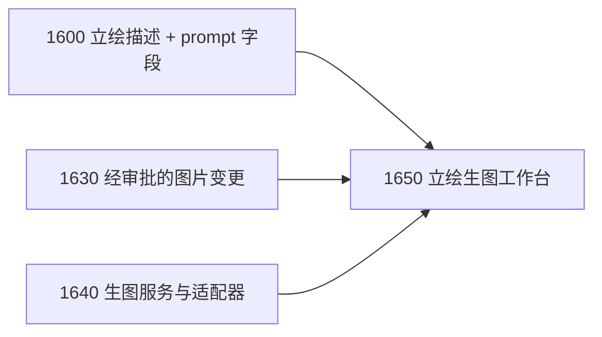

# 角色立绘生图模块规划

> 日期：2026-11-12
> 代码基线：`fd764cc`
> 状态：已立项。作者于 2026-11-12 要求增加独立的角色立绘生图模块，对接 ComfyUI HTTP 接口或在线生图 API，并在角色卡立绘中增加生图提示词字段。拆为 [1630](../tasks/1630.md)–[1650](../tasks/1650.md) 三个 Planned task，并扩展 [1600](../tasks/1600.md) 的立绘字段。实施计划待写。
> 关联：[Play 角色对话 GalGame 化规划](PLAY_GALGAME_PRESENTATION_PLAN_2026-11-12.md)。

## 1. 结论

生图是一个**独立模块**，由作者在“立绘生图”页面显式触发；Play 推演运行中不调用生图，舞台只读取已经审批写入工作区的图片。这与 [1360](../tasks/1360.md) “Play 不调用生图 / TTS”的边界一致：边界针对 Play 运行时，不针对独立的素材准备模块。

| 编号 | Task | 作者获得的能力 | 改动面 | 优先级 / 规模 |
| --- | --- | --- | --- | --- |
| G0 | [1600](../tasks/1600.md)（扩展） | 每张立绘可保存生图提示词 | Core 名册字段 + 表单 | 随 1600 |
| G1 | [1630](../tasks/1630.md) 经审批的图片文件变更 | 图片也能走 CandidateChangeSet → PendingAction → Git diff 审批写入 | ADR + Core/Tools 变更引擎 + Desktop diff | P0 / L |
| G2 | [1640](../tasks/1640.md) 生图服务配置与适配器 | 配置本地 ComfyUI 或在线生图 API，测试连通 | Core 类型 + Backend 适配器 + 全局配置 + Desktop 设置 | P1 / M–L |
| G3 | [1650](../tasks/1650.md) 角色立绘生图工作台 | 选角色与立绘 → 生成候选 → 挑一张 → 审批写入角色卡 | Backend 任务 + Desktop 页面 | P1 / L |

顺序：1600 → 1630 与 1640 可并行 → 1650。1640 单独交付没有作者可见的成果，所以与 1650 同为 P1；1630 是 P0，因为它改动正式写入合同，需要最早定稿。

本规划改变了此前“生图不进入范围”的记录（[DEVELOPMENT_PLAN](../DEVELOPMENT_PLAN.md)、[2026-11-06 路线图](NEXT_FEATURE_ROADMAP_2026-11-06.md)）；两处已加注 2026-11-12 的更新。TTS 仍不做。

## 2. 现状核对

| 事实 | 依据 |
| --- | --- |
| 名册 `looks` 已有 `fixedBooruTags`、`outfitTags`、`loraName`、`loraTrigger`，预留给生图，但无任何调用方 | `character-roster.ts` |
| Sandbox Change Engine 只接受无 NUL 的 UTF-8 文本，create 固定 mode `0o644` | [SANDBOX_CHANGE_ENGINE](../SANDBOX_CHANGE_ENGINE.md) §change 合同 |
| LLM provider 配置是应用级全局配置 `llm-providers.json`，`apiKey` 对前端脱敏为 `hasApiKey` | `llm-provider.ts`、[0540](../tasks/0540.md) |
| 所有模型调用统一走 Vercel AI SDK；`ai@7` 提供 `generateImage` | `packages/*/package.json`、[ADR 0002](../adr/0002-no-heavy-agent-frameworks.md) |
| 会话冻结立绘单张 256 KiB | [PLAY_LOCAL_SCENERY](../PLAY_LOCAL_SCENERY.md) |

## 3. 各项设计

### 3.1 立绘生图提示词字段（扩展 1600）

`portraits.items[]` 增加可选 `prompt`；采纳生成图后写入可选 `generation` 来源记录：

```yaml
portraits:
  default: normal
  items:
    - id: normal
      label: 平常
      description: 双手背在身后，微微歪头，嘴角带一点笑。
      image: characters/nian/portraits/normal.png
      prompt:
        positive: smile, hands behind back, head tilt, school uniform, upper body
        negative: lowres, bad hands, extra fingers
        useCharacterTags: true      # 默认 true：自动拼上 looks.fixedBooruTags / outfitTags / LoRA 触发词
      generation:                   # 由 1650 采纳时写入，作者也可删除
        provider: comfyui-local
        model: animagine-xl-4.0
        seed: 123456789
        size: 832x1216
        workflowHash: sha256:…
        promptHash: sha256:…
        generatedAt: 2026-11-12T20:00:00+08:00
```

- `prompt` 是纯文本，没有生图模块时也可以编辑保存；提示词语言不限。
- 最终提示词由 Core 纯函数组合：角色固定 tags + 服装 tags + LoRA 触发词 + 本立绘 `positive`；`negative` 叠加服务的默认负面词。组合结果在生成前可预览、可临时修改，临时修改不回写，除非作者显式保存。
- `generation` 只记来源，不含 API Key、服务地址或完整工作流内容。

### 3.2 经审批的图片文件变更（1630）

生成的图片要进入 `characters/<id>/portraits/`，必须走唯一正式写入架构。当前变更引擎只支持文本，需要先扩展：

- **新增 ADR 0005**：允许 CandidateChangeSet 携带受限的二进制图片变更。修改 [SANDBOX_CHANGE_ENGINE](../SANDBOX_CHANGE_ENGINE.md) 中“只支持 UTF-8 text”的合同。
- **范围最小**：只允许 PNG / JPEG / WebP；只允许路径 `characters/<id>/portraits/*.{png,jpg,jpeg,webp}`；只支持 create 与 update（替换）；校验魔数、尺寸上限、单文件与单 action 总量上限。
- **只由确定性 producer 生成**：二进制条目只能由宿主代码（1650 的采纳、未来的 Tavern 卡图片导入）产生；模型与 just-bash 投影看不到、不能编辑二进制内容；Accept 不重放命令。
- **存储**：draft 以内容寻址 blob 存在 `.workspace/change-engine/v1` 下，记录 sha256 与字节数；materializer 沿用 CAS / staged write / 恢复路径，写入前校验 baseline（create 要求目标不存在，update 要求 baseline hash）。
- **审批界面**：diff 视图对图片显示预览（update 时新旧并排）、尺寸与大小；与同一 action 中的 YAML 文本变更一起审批。
- **需要修改的不变量**：[HUMAN_APPROVAL_AND_GIT](../HUMAN_APPROVAL_AND_GIT.md) 规定 Renderer 不接收 candidate bytes。图片不看到就无法审批，所以 ADR 0005 要把这条收窄为：Renderer 仍不接收 artifact 路径和文本候选的原始字节；图片候选只能通过一个只读预览接口取得，接口按 action id 与变更序号定位，只在该 action 待审批期间可用，返回的字节不超过图片条目的大小上限。默认直接返回候选图片本身，由界面缩放显示，不为预览引入图片编解码依赖。
- **schema 版本**：ChangeSet 与 PendingAction 是严格的 `schemaVersion: 1`，项目又不允许兼容 reader 和旧记录迁移器。默认做法是把图片条目作为 v1 的一个新增变更种类：已有的纯文本记录本身仍是合法记录，不需要迁移或第二套读取逻辑；旧版本应用读到含图片条目的记录时按未知种类拒绝。ADR 0005 须确认这一做法，或改为升版并说明未决 PendingAction 的处置。
- **Git**：Accept 后按 `git.autoCommitOnAccept` 正常提交；关闭时不 commit / sync。

### 3.3 生图服务配置与适配器（1640）

- **全局配置** `image-providers.json`，与 `llm-providers.json` 同目录、同样的脱敏规则；不进入小说工作区。
- **适配器接口**（Core 只定义类型；网络调用在 Backend）：
  ```ts
  interface PortraitImageRequest { positive: string; negative?: string; width: number; height: number; seed?: number; count: number; }
  interface PortraitImageResult { images: Array<{ bytes: Uint8Array; mediaType: 'image/png' | 'image/jpeg' | 'image/webp'; seed?: number }>; providerMeta: Record<string, string | number> }
  ```
- **ComfyUI HTTP 适配器**：
  - 作者导入 ComfyUI “API 格式”工作流 JSON，并指定占位映射（正向 / 负向提示词、种子、宽高、批量、LoRA 节点等）；也可在 JSON 中使用 `{{positive}}` 等占位符。
  - 流程：`POST /prompt` → 轮询 `GET /history/{prompt_id}` → `GET /view` 取图；支持 `POST /interrupt` 取消；`GET /system_stats` 做连通测试。
  - 默认只允许 loopback 地址；远程地址需在设置中显式开启并提示风险。工作流文件存全局配置目录，记录 hash。
- **在线 API 适配器**：走 Vercel AI SDK `generateImage`，复用已有 provider 包（如 `@ai-sdk/openai`）；需要额外 provider 时在实施计划中按固定版本引入。不手写私有 HTTP 客户端。
- **用量与外发记录**：每次生图请求按 [1110](../tasks/1110.md) 已有的做法记一条外发记录：服务 id 与类型、模型、地址的 origin、张数与尺寸、耗时与结果；不记提示词原文、图片内容、API Key 或完整地址。本机 loopback 的 ComfyUI 也记录，标为本地。
- **统一约束**：请求超时、单次最多张数、返回图片字节上限、魔数校验；失败给出具体原因（不可达、鉴权失败、超时、内容被拒、返回格式错误）。
- **设置页**：新增、编辑、删除服务，测试连通；API Key 只写不回显。

### 3.4 角色立绘生图工作台（1650）

- 独立页面“立绘生图”，从工作区导航或角色页立绘表单进入。
- 选择角色与立绘项（或新建立绘项）→ 预览组合后的提示词 → 选服务、尺寸、张数、种子 → 生成。
- 可选“根据描述起草提示词”：用已配置的 LLM 把 `description` 与角色外观起草为提示词，只填入表单，不写文件。这是一次只读的模型调用，发出前说明会把哪些角色资料发给哪个模型，并计入现有用量记录。
- 生成结果暂存在 `.workspace/portrait-gen/<job-id>/`（系统内部、非正式文件，不进 Git），画廊浏览；可重新生成、固定种子微调。这个内部目录要写进 [FILESYSTEM_SPEC](../FILESYSTEM_SPEC.md)，并与其他 `.workspace` 目录一样对 Agent 的读取与枚举不可见。
- 选中一张 → “采用” → 宿主生成一个 PendingAction：创建 / 替换图片文件 + 更新 `roster-profile.yaml` 中该立绘的 `image`、`prompt`、`generation` → Git diff 审批 → Accept。
- 任务管理：同一工作区同时最多一个生成任务；可取消；应用重启后未完成任务标为中断；暂存图片按数量与天数上限清理，已采用的不受影响。
- Play 不感知生图：已打开的会话保留冻结字节，新会话才使用新图。

## 4. 待定决策（写实施计划时确定）

1. **舞台用图尺寸**：生成图常在 1–3 MiB，超过会话冻结单张 256 KiB。可选：(a) 采纳时缩放转码为舞台版本（需要引入图片编解码依赖，固定版本、随桌面包分发）；(b) 提高冻结预算（影响 [1260](../tasks/1260.md) 的会话存储成本）；(c) 要求工作流直接输出小图。**默认取 (a)，且只把舞台版本写入工作区，原图不入库**：原图留在暂存区直到被清理。这样 1600 的 `image` 保持单个字段、1630 的允许路径不变，Git 仓库也不会每张立绘增长几 MiB。作者若要长期保留原图，需要改这条默认，并相应扩展 1600 的字段与 1630 的路径——所以这一条必须在 1600 定稿字段之前确认。
2. **透明底立绘**：是否在 1650 中支持“去背景”（ComfyUI 工作流内完成，或本地纯色抠图）。建议先只依赖工作流，本地抠图进候选池。
3. **首批在线服务**：选择哪一两家（以 AI SDK 已支持且作者常用为准）。

## 5. 不做

- Play 推演运行中不生图、不改图；裁判不能触发生图。
- 不做 TTS、语音克隆、视频生成、LoRA 训练。
- 不托管模型、不内置 ComfyUI、不下载模型文件。
- 不自动采用任何生成结果；所有落盘经 PendingAction 审批。
- API Key、服务地址、工作流不写入小说工作区或 Git。

## 6. 候选池

- Tavern PNG 卡图片作为默认立绘（依赖 1630）。
- 本地纯色 / 绿幕抠图。
- 批量为多个角色的多张立绘排队生成。
- 场景背景图生成（`world/places/`），需要扩展 1630 的允许路径。
- img2img / 参考图保持一致性（以已有立绘为参考生成新表情）。

## 7. 顺序与依赖



测试放在 `__test__/core/`（提示词组合、名册字段、二进制变更校验）、`__test__/tools/`（materializer 二进制写入与恢复）、`__test__/backend/`（ComfyUI 与在线 API 适配器，用本地 mock HTTP 服务）、`__test__/desktop-ui/`（设置页、工作台、diff 图片预览）。真实服务的出图质量由作者另行验收。
